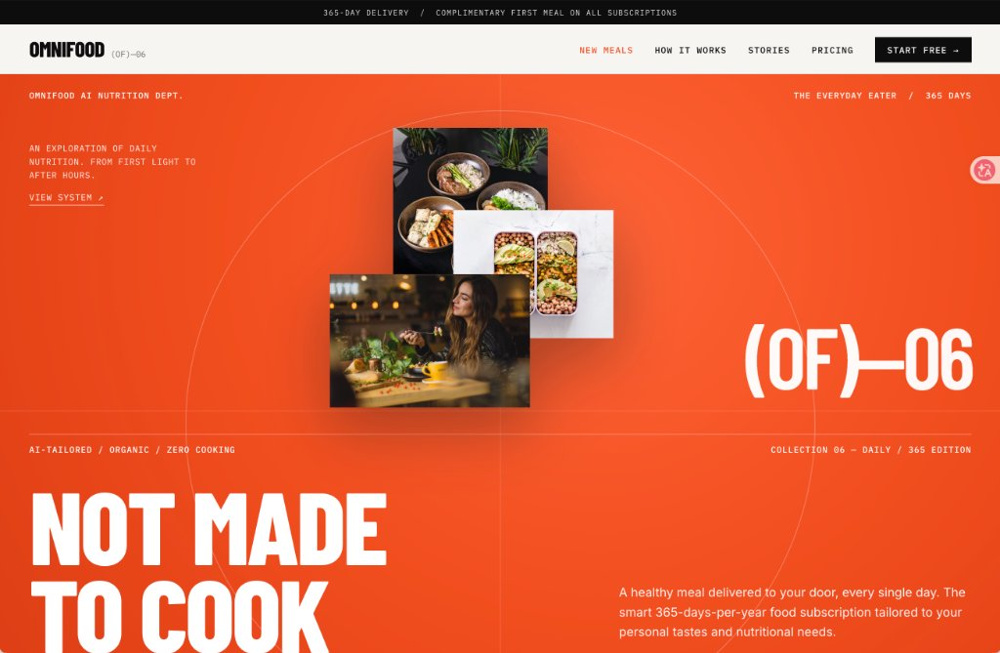

# Omnifood

> High-contrast editorial landing page for an AI-powered daily meal subscription, built with Vite, build-time HTML partials, W3C Native CSS Nesting, BEM, and minimal ES Modules.



## Overview

Omnifood is a responsive marketing website redesigned with a Swiss-grid, technical editorial aesthetic — featuring a vivid vermilion (`#f24e1e`) hero canvas, stark black (`#0d0d0d`) typography and structural accents, crisp off-white (`#f6f5f2`) and studio gray (`#efeeea`) surfaces, condensed uppercase display headings (`Barlow Condensed`), monospace technical labels (`IBM Plex Mono`), and clean body copy (`Inter`).

## Key Features

- **Co-Located Section Architecture**: Each page section lives in its own folder under `app/sections/<section>/` pairing `<section>.html` and `<section>.css` side by side.
- **Build-Time HTML Composition**: Powered by `vite-plugin-html-inject` (`<load src="./sections/<section>/<section>.html" />`), eliminating runtime `fetch()` HTML loaders and preventing layout shifts.
- **Modern CSS Architecture**: Built with explicit `@layer` cascade ordering (`reset, tokens, base, components, sections, utilities`), `:root` design tokens, valid W3C Native CSS Nesting, BEM naming conventions, and zero global `*` resets.
- **Minimal JavaScript Footprint**: Vanilla ES Modules reserved strictly for genuine interactivity (mobile navigation drawer, sticky header `IntersectionObserver`, Meals diet category filter, and CTA signup form validation) — producing a `~2.6 kB` (`~1.2 kB` gzip) production bundle.
- **Section-Organized Assets**: All 34 image assets are grouped by section under `app/assets/img/`.
- **Performance & Accessibility**: Semantic landmarks, single `<h1>`, `fetchpriority="high"` on the hero LCP image, `loading="lazy"` with explicit dimensions on off-screen media, `autocomplete` + `inputmode` form tokens, and `prefers-reduced-motion` support.

## Project Structure

```text
omnifood/
├── app/
│   ├── index.html                  # Document shell composing sections via <load />
│   ├── sections/                   # Co-located HTML + CSS per section
│   │   ├── header/                 # header.html + header.css
│   │   ├── hero/                   # hero.html + hero.css
│   │   ├── featured/               # featured.html + featured.css
│   │   ├── how/                    # how.html + how.css
│   │   ├── meals/                  # meals.html + meals.css
│   │   ├── testimonials/           # testimonials.html + testimonials.css
│   │   ├── pricing/                # pricing.html + pricing.css
│   │   ├── cta/                    # cta.html + cta.css
│   │   └── footer/                 # footer.html + footer.css
│   ├── styles/                     # Global layered CSS
│   │   ├── main.css                # @layer order & stylesheet imports
│   │   ├── tokens.css              # :root design tokens
│   │   ├── base.css                # Scoped resets, typography & container
│   │   └── components.css          # Reusable BEM UI primitives
│   ├── scripts/                    # Minimal native ES Modules
│   │   ├── main.js                 # App entry point & dynamic copyright year
│   │   ├── navigation.js           # Mobile nav drawer & sticky header observer
│   │   ├── meals-filter.js         # Interactive diet category filtering
│   │   └── cta-form.js             # Signup form validation & status feedback
│   └── assets/
│       └── img/                    # Section-grouped images (brand, hero, featured, ...)
├── docs/
│   └── preview.jpg                 # README hero preview
├── package.json
├── vite.config.js                  # Vite config (root: "app", outDir: "../dist")
├── .prettierrc                     # Shared Prettier formatting rules
├── agents.md                       # Engineering & architecture guidelines
└── license
```

## Getting Started

### Prerequisites

- Node.js `>= 20`
- npm `>= 10`

### Installation & Development

```bash
# Install dependencies
npm install

# Start local dev server with HMR
npm run dev

# Build for production (outputs to /dist)
npm run build

# Preview production build locally
npm run preview
```

## Engineering Conventions

Detailed architecture, CSS nesting, BEM naming, accessibility, and Git workflow rules are documented in [agents.md](./agents.md) and synced with [.prettierrc](./.prettierrc).

## Credits & License

- Originally inspired by the [Build Responsive Real-World Websites with HTML and CSS](https://www.udemy.com/course/design-and-develop-a-killer-website-with-html5-and-css3/) course case study, refactored into a modern Vite + W3C CSS architecture.
- Licensed under the terms in [license](./license).
